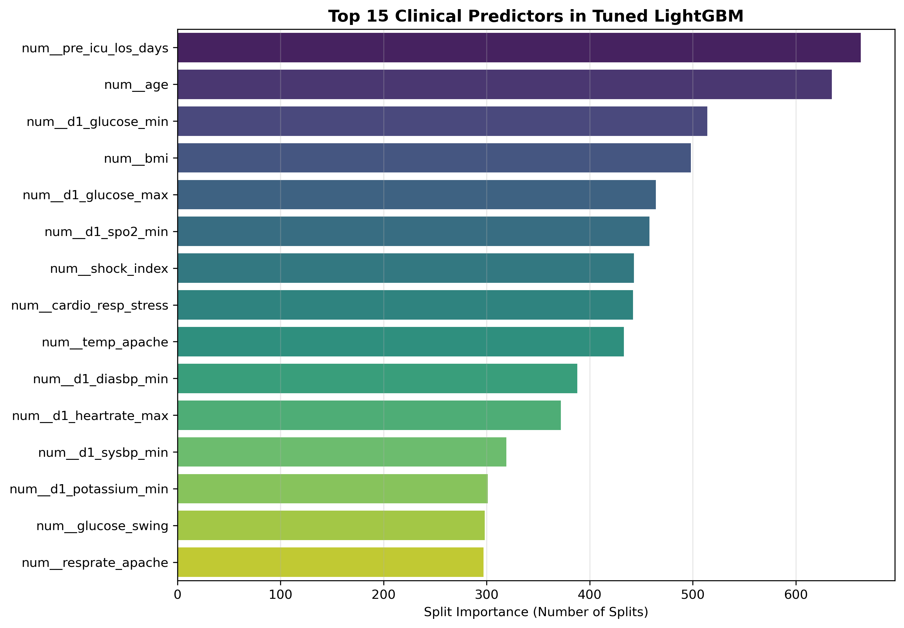
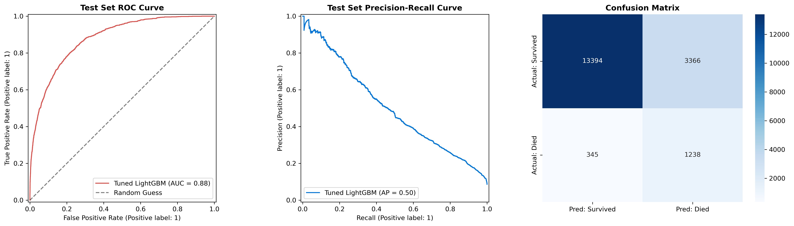

# ICU In-Hospital Mortality Prediction Using Machine Learning

A machine learning project focused on predicting in-hospital mortality among Intensive Care Unit (ICU) patients using clinical, physiological, and demographic data.

## Project Overview

Predicting patient outcomes in intensive care is an important challenge in clinical decision support. Identifying patients who may be at increased risk of mortality can help healthcare professionals prioritize clinical assessment and resource allocation.

This project develops and evaluates multiple machine learning classification algorithms to estimate the probability of in-hospital mortality using patient demographics, vital signs, laboratory measurements, and clinical indicators.

Five classification algorithms were investigated and compared using stratified five-fold cross-validation. LightGBM achieved the best baseline performance and was subsequently optimized using RandomizedSearchCV.

The optimized model achieved a **ROC-AUC of 0.8780 on an independent holdout test set**.

An interactive Streamlit application accompanies the project to demonstrate the model's prediction capabilities.

## Project Objectives

- Explore clinical and physiological factors associated with ICU in-hospital mortality.
- Develop a reproducible machine learning classification pipeline.
- Engineer additional features informed by clinical relationships.
- Compare the predictive performance of multiple classification algorithms.
- Optimize model hyperparameters using RandomizedSearchCV.
- Evaluate the selected model using an independent holdout test set.
- Develop an interactive application for demonstrating mortality-risk predictions.

## Dataset

The project uses an ICU patient dataset containing **91,713 patient records**.

**Dataset source:** [Patient Dataset – Kaggle](https://www.kaggle.com/datasets/mitishaagarwal/patient)

The prediction target is `hospital_death`, a binary variable indicating whether a patient died during hospitalization.

### Feature Categories

| Category | Selected Features |
|---|---|
| Demographics | Age, BMI |
| ICU admission | Pre-ICU length of stay, ICU admission source |
| Cardiovascular | Heart rate, systolic and diastolic blood pressure |
| Respiratory | Respiratory rate, oxygen saturation, temperature |
| Metabolic | Glucose and potassium measurements |
| Neurological | Glasgow Coma Scale components |
| Clinical interventions | Mechanical ventilation and intubation |
| Patient characteristics | Gender, APACHE 3J body system |

The dataset contains missing observations and an imbalanced target distribution, both of which were considered during model development.

## Methodology

The project follows a structured machine learning workflow.

### 1. Exploratory Data Analysis

Exploratory analysis was performed to understand the dataset and identify relevant patterns.

Key activities included:

- Dataset inspection and statistical summaries.
- Missing-value analysis.
- Target variable distribution analysis.
- Categorical feature exploration.
- Correlation analysis.
- Examination of relationships between clinical variables and mortality.

### 2. Train-Test Splitting

A stratified train-test split was implemented to preserve the original distribution of the target variable across both partitions.

- Training set: 80%
- Testing set: 20%

The holdout test set was kept separate from model development and used for final performance evaluation.

### 3. Data Preprocessing

A Scikit-learn preprocessing pipeline was developed to ensure consistent transformations during model training, cross-validation, and inference.

| Feature Type | Preprocessing |
|---|---|
| Numerical | Median imputation and standardization |
| Categorical | Constant-value imputation and one-hot encoding |
| Binary | Most-frequent imputation |

`ColumnTransformer` and Scikit-learn `Pipeline` were used to combine the transformations into a reusable workflow.

The initial standalone imputation and encoding operations were also used during exploratory analysis on the training partition. The model-development pipeline contains its own preprocessing steps.

### 4. Feature Engineering

Additional features were engineered to capture potentially relevant physiological relationships.

| Engineered Feature | Description |
|---|---|
| Shock Index | Heart rate relative to systolic blood pressure |
| Pulse Pressure | Difference between systolic and diastolic blood pressure |
| GCS Eye-Motor | Combined Glasgow Coma Scale eye and motor response scores |
| Glucose Swing | Difference between maximum and minimum glucose measurements |
| Potassium Swing | Difference between maximum and minimum potassium measurements |
| Cardiorespiratory Stress | Derived relationship involving heart rate, respiratory rate, and oxygen saturation |

These features were incorporated into the numerical preprocessing pipeline using a custom Scikit-learn-compatible transformer.

### 5. Model Development

Five classification algorithms were evaluated:

1. Logistic Regression
2. Random Forest Classifier
3. Histogram-based Gradient Boosting Classifier
4. XGBoost Classifier
5. LightGBM Classifier

Stratified five-fold cross-validation was used for model comparison, with ROC-AUC as the primary evaluation metric.

Class imbalance was also considered through class weighting and positive-class weighting where applicable.

### 6. Model Comparison

The baseline models were evaluated using their mean five-fold cross-validation ROC-AUC scores.

| Model | Mean Cross-Validation ROC-AUC |
|---|---:|
| Logistic Regression | 0.8566 |
| Random Forest | 0.8546 |
| Histogram Gradient Boosting | 0.8690 |
| XGBoost | 0.8677 |
| **LightGBM** | **0.8696** |

LightGBM achieved the highest baseline cross-validation ROC-AUC and was selected for further optimization.

### 7. Hyperparameter Optimization

RandomizedSearchCV was used to optimize the LightGBM classifier.

The search explored different configurations of:

- Number of estimators
- Learning rate
- Number of leaves
- Maximum tree depth
- Minimum child samples
- Subsampling
- Feature subsampling

**Best hyperparameters:**

| Parameter | Optimized Value |
|---|---:|
| `n_estimators` | 300 |
| `learning_rate` | 0.03 |
| `num_leaves` | 31 |
| `max_depth` | 12 |
| `min_child_samples` | 100 |
| `subsample` | 0.8 |
| `colsample_bytree` | 0.8 |

**Best cross-validation ROC-AUC: 0.8727**

### 8. Final Model Evaluation

The optimized LightGBM pipeline was evaluated on the independent stratified holdout test set.

**Final Test ROC-AUC: 0.8780**

The evaluation workflow includes:

- ROC curve analysis.
- Precision-recall curve analysis.
- Confusion matrix.
- Classification report.
- Feature importance analysis.

## Results Summary

| Evaluation Stage | ROC-AUC |
|---|---:|
| Best baseline cross-validation | 0.8696 |
| Optimized cross-validation | 0.8727 |
| Independent holdout test | **0.8780** |

The optimized LightGBM model achieved improved cross-validation performance over the baseline model and obtained a final test ROC-AUC of 0.8780.

## Model Evaluation Visualizations

Visualizations generated during model evaluation will be included here.

Once the figures have been saved in the repository, you can display them using:

```markdown



```

## Streamlit Application

An interactive web application was developed using Streamlit to demonstrate the trained model.

The application allows users to enter selected patient characteristics, clinical measurements, and physiological indicators to obtain a model-generated estimate of in-hospital mortality probability.

**Live Application:** [Launch Streamlit Application](YOUR_STREAMLIT_APP_URL)

## Technologies and Libraries

- **Programming Language:** Python
- **Data Manipulation:** Pandas, NumPy
- **Data Visualization:** Matplotlib, Seaborn
- **Machine Learning:** Scikit-learn
- **Gradient Boosting:** XGBoost, LightGBM
- **Hyperparameter Optimization:** RandomizedSearchCV
- **Deployment:** Streamlit
- **Model Serialization:** Pickle

## Project Structure

```text
icu-mortality-prediction/
│
├── app.py
├── hospital_icu_mortality.ipynb
├── icu_mortality_model.bin
├── transformers.py
├── requirements.txt
├── README.md
│
└── assets/
    ├── figures/
    │   ├── feature_importance.png
    │   └── test_evaluation.png
    │
    └── screenshots/
        └── app_screenshot.png
```

## Installation and Usage

### 1. Clone the repository

```bash
git clone https://github.com/YOUR_USERNAME/icu-mortality-prediction.git
cd icu-mortality-prediction
```

### 2. Create a virtual environment

```bash
python -m venv venv
```

Activate the environment:

**Windows**

```bash
venv\Scripts\activate
```

**macOS/Linux**

```bash
source venv/bin/activate
```

### 3. Install dependencies

```bash
pip install -r requirements.txt
```

### 4. Run the application

```bash
streamlit run app.py
```

The application will be available locally through your browser.

## Limitations and Responsible Use

This project is an educational and research-oriented machine learning prototype.

The predicted mortality probabilities are model-generated estimates based on patterns learned from the training dataset. They should not be interpreted as definitive clinical outcomes, validated clinical risk scores, or substitutes for professional medical judgment.

The model has not been established as clinically validated for real-world patient management.

Further work would be required to assess external validity, probability calibration, subgroup performance, clinical utility, and potential biases before considering deployment in a healthcare environment.

## Future Improvements

- External validation using independent ICU datasets.
- Probability calibration and decision-threshold optimization.
- Model explainability using SHAP.
- Evaluation across clinically relevant patient subgroups.
- Further investigation of class imbalance.
- Additional model performance and robustness analysis.
- Improved clinical interpretability of predictions.

## Author

**Azeez Idris**

Biomedical Engineering | Machine Learning | Data Science

- GitHub: [Emhirate](https://github.com/emhirate)
